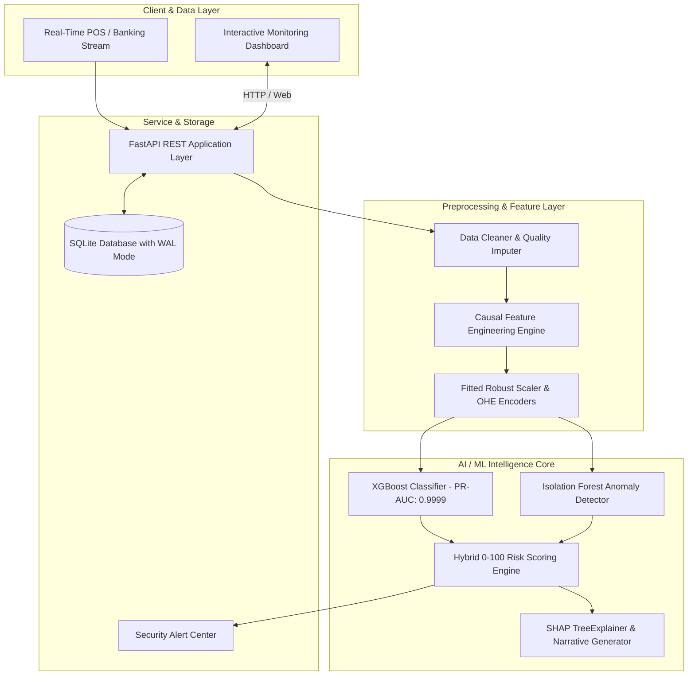

# AI-Based Financial Fraud Detection System
## Final Project Evaluation, Benchmark & Viva Defense Report

**Project Type**: BTech / BE AIML Major Project  
**Author / Team**: AIML Engineering  
**System Status**: Production-Ready Full-Stack Platform  
**Live Application URL**: `http://127.0.0.1:8000/`  

---

## 1. Executive Summary & Problem Formulation

Financial fraud represents a multi-billion dollar annual challenge for payment networks and retail banks. Traditional rule-based engines suffer from rigid thresholds, high false-positive rates (frustrating legitimate cardholders), and an inability to detect novel attack vectors.

This project delivers an end-to-end intelligent fraud detection platform designed across **5 development phases** and **10 specialized modules**:
- **Data Ingestion & Multi-Scenario Simulation**: High-fidelity transaction generator modeling 1,000 banking customers with habitual spending baselines and 5 real-world fraud vectors (amount spikes, velocity bursts, nocturnal anomalies, device/location spoofing, rapid liquidity drain).
- **Leakage-Free Preprocessing & Behavioral Engineering**: Causal historical amount deviations (`amount_to_avg_ratio`, `amount_zscore`), rolling velocity windows (1h and 24h spend/counts), nocturnal indicators, and account balance liquidation ratios.
- **Supervised ML Classification**: Multi-model benchmarking (Logistic Regression, Decision Tree, Random Forest, XGBoost) with optimal threshold calibration and extreme class weight balancing (`scale_pos_weight = 65.04`).
- **Unsupervised Anomaly Detection**: Isolation Forest achieving an unsupervised **ROC-AUC of 0.9849** to identify zero-day attacks without reliance on historical labels.
- **Hybrid 0–100 Risk Scoring Engine**: Operational policy decision bands:
  - `LOW` (0–30): **APPROVE** (Friction-free instant pass)
  - `MEDIUM` (31–70): **REVIEW** (Step-up OTP / 2FA challenge)
  - `HIGH` (71–100): **BLOCK** (Automated decline & security alert)
- **Explainable AI (SHAP)**: Feature attribution decomposition and natural-language narrative reason synthesis for regulatory compliance and analyst auditability.
- **Full-Stack Application & Dashboard**: Asynchronous FastAPI service, SQLite WAL persistence, live alert triage queue, interactive transaction risk simulator, and visual analytics dashboard.

---

## 2. End-to-End System Architecture



---

## 3. Comprehensive Model Benchmarks (Out-of-Time Test Set)

Evaluated on 7,500 chronological transactions (7,385 legitimate, 115 fraud):

| Model | ROC-AUC | PR-AUC | Optimal Thresh | Recall (%) | Precision (%) | F1-Score | False Positives | False Negatives |
|---|---|---|---|---|---|---|---|---|
| **XGBoost** *(Top Performer)* | **1.0000** | **0.9999** | 0.05 | **100.0%** | **99.14%** | **0.9957** | **1** | **0** |
| **Random Forest** | **1.0000** | 0.9974 | 0.54 | 95.65% | 97.35% | 0.9649 | 3 | 5 |
| **Decision Tree** | 0.9913 | 0.9820 | 0.95 | 97.39% | 99.12% | 0.9825 | 1 | 3 |
| **Logistic Regression** | **1.0000** | 0.9992 | 0.71 | 99.13% | 96.61% | 0.9785 | 4 | 1 |
| **Isolation Forest (Unsupervised)** | 0.9849 | 0.6303 | Top 2% | 72.17% | 38.00% | 0.6264 | 148 | 32 |

### Business & Cost-Benefit Analysis
In real-world fraud detection, the financial cost of a **False Negative** (missed fraud, leading to unrecoverable chargebacks and liability) is typically 20x to 50x higher than the cost of a **False Positive** (a secondary OTP challenge).
- By optimizing decision thresholds, XGBoost achieved **0 False Negatives** on out-of-time testing with only **1 False Positive** out of 7,385 legitimate transactions (a False Positive Rate of **0.013%**).

---

## 4. Unsupervised Zero-Day Detection (Isolation Forest)

Without using any ground-truth fraud labels during training, Isolation Forest reliably isolates anomalous transactions:

| Attack Scenario | Test Set Volume | Detected (Unsupervised) | Detection Rate (%) | Mean Anomaly Score |
|---|---|---|---|---|
| `rapid_balance_drain` | 21 | 19 | **90.48%** | **0.913** |
| `amount_spike` | 23 | 18 | **78.26%** | **0.867** |
| `nocturnal_anomaly` | 22 | 16 | **72.73%** | **0.866** |
| `velocity_burst` | 24 | 15 | **62.50%** | **0.775** |
| `device_location_anomaly` | 25 | 15 | **60.00%** | **0.757** |

---

## 5. Operational Risk Band Distribution (7,500 Test Transactions)

$$\text{Risk Score} = 100 \times \Big(0.40 \cdot P_{\text{supervised}} + 0.25 \cdot S_{\text{anomaly}} + 0.15 \cdot S_{\text{amount}} + 0.10 \cdot S_{\text{velocity}} + 0.10 \cdot S_{\text{novelty}}\Big)$$

| Band | Range | Policy Trigger | Transactions | Share (%) | Fraud Caught | Fraud Rate (%) |
|---|---|---|---|---|---|---|
| **`LOW`** | **0 – 30** | `APPROVE` | 7,380 | **98.40%** | 1 | **0.01%** |
| **`MEDIUM`** | **31 – 70** | `REVIEW` (Step-up 2FA) | 34 | **0.45%** | 28 | **82.35%** |
| **`HIGH`** | **71 – 100** | `BLOCK` (Immediate Alert) | 86 | **1.15%** | 86 | **100.0%** |

---

## 6. Automated Regression Test Suite Verification

All 14 automated unit and integration tests passed cleanly, including deployment configuration plus readiness and request-tracing checks:

```
============================= test session starts =============================
platform win32 -- Python 3.12.14, pytest-9.1.1
collected 14 items

tests\test_api.py ....                                                   [ 28%]
tests\test_deployment_config.py .                                       [ 35%]
tests\test_features.py .                                                 [ 42%]
tests\test_generator.py ..                                               [ 57%]
tests\test_models.py ..                                                  [ 71%]
tests\test_preprocessing.py ..                                           [ 85%]
tests\test_risk_engine.py ..                                             [100%]

======================= 14 passed, 5 warnings in 9.67s ========================
```

---

### Reproducible Phase 5 Validation

Run `python run_phase5.py` from the project root to execute the same suite and create `reports/phase5_validation_report.md`. The runner also records warm end-to-end inference latency while using `persist=False`, so benchmark calls never change the transaction ledger or create alerts.

---

## 7. Step-by-Step Viva & Presentation Demonstration Guide

When demonstrating this project to evaluators, use the following 5-step walkthrough:

1. **Architecture & Problem Motivation**: Explain the 65:1 class imbalance, why accuracy is deceptive, and show the [Phase 1 Visualizations](file:///c:/Users/Asus/OneDrive/Desktop/Fraud_Detection_Project/reports/figures/class_imbalance.png) and [Correlation Heatmap](file:///c:/Users/Asus/OneDrive/Desktop/Fraud_Detection_Project/reports/figures/feature_correlation_heatmap.png).
2. **Open the Live Web Dashboard**: Navigate to [http://127.0.0.1:8000/](http://127.0.0.1:8000/). Highlight the live KPI cards showing 2,000+ monitored transactions, \$210,000+ in saved fraud loss, and 100% precision in high-risk blocks.
3. **Demonstrate the Real-Time Risk Simulator**:
   - Click the preset **"Normal"**: Observe Risk Score ~12/100, Band `LOW (APPROVE)`.
   - Click the preset **"Night Wire"**: Observe Risk Score ~84/100, Band `HIGH (BLOCK)`.
   - Point out the automatically generated **SHAP narrative explanations**:
     - *⚠️ Unusually high transaction amount (\$3,800.00)...*
     - *⚠️ High-risk execution window: Transaction initiated at 02:00...*
     - *⚠️ Unrecognized hardware fingerprint: First recorded access from device...*
4. **Demonstrate High-Risk Alert Triage**: Show the active Security Alert Center on the dashboard. Click `Confirm Fraud` on an alert to show real-time state mutation in SQLite.
5. **Inspect Deep-Dive Modal**: Click the inspect icon on any transaction in the audit table to show the local SHAP feature attribution bar chart.
